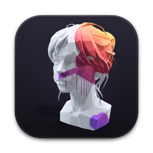
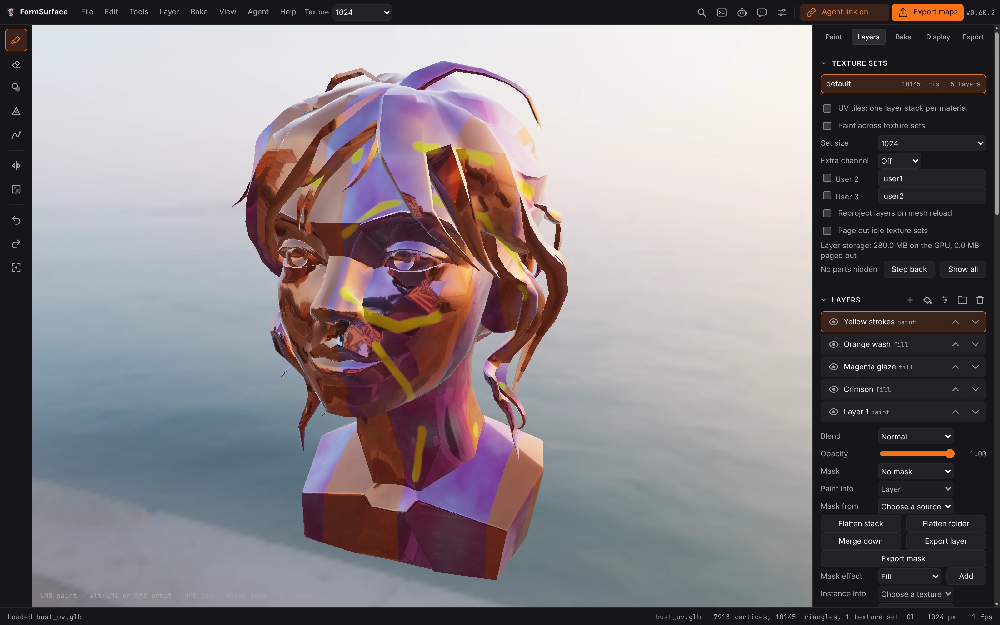
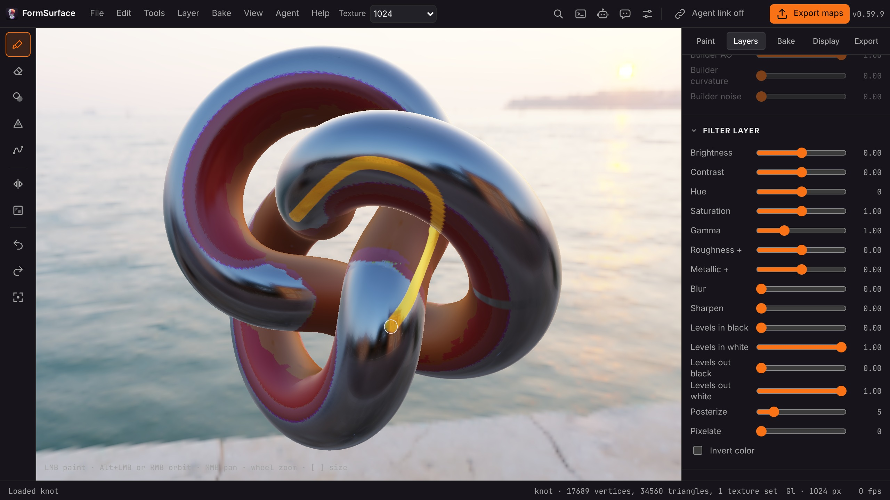
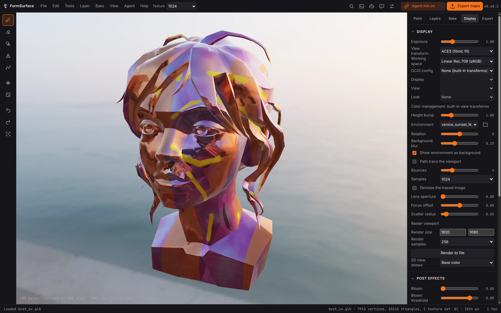
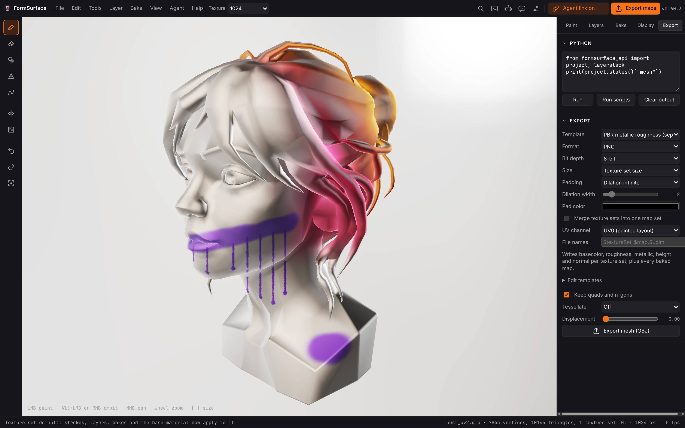

<p align="center">
  
</p>

<h1 align="center">FormSurface</h1>

<p align="center">
  <b>3D texture painting; paint straight onto the model, layer by layer.</b><br>
  Projection painting, fill layers, generators and baking,<br>
  with PBR export for game engines and renderers. Local-first, no account, and agents can paint too.
</p>

<p align="center">
  
  
  
  
  
  
</p>

<p align="center">
  <a href="https://formsurface.formai.studio/"><b>Download FormSurface on formai.studio</b></a> ·
  <a href="#run-it-from-source">Run it from source</a>
</p>

<br>

<p align="center">
  
  <br>
  <sub>The FormSurface icon recreated in the app: the icon's own paint projected from the camera onto a grey plaster bust as one fill layer, lit by a soft dark studio environment. The Layers tab lists the stack.</sub>
</p>

<p align="center">
  <a href="#features">Features</a> ·
  <a href="#everything-in-the-box">In the box</a> ·
  <a href="#built-for-agents">Agents</a> ·
  <a href="#under-the-hood">Under the hood</a> ·
  <a href="#download">Download</a> ·
  <a href="#run-it-from-source">Run from source</a>
</p>

<br>

<table>
  <tr>
    <td width="25%" valign="top">
      <h3>Paint in 3D</h3>
      The brush hits the mesh in world space and writes into the UV textures, so strokes cross seams without stretching.
    </td>
    <td width="25%" valign="top">
      <h3>Layers that stay editable</h3>
      Paint, fill and filter layers with masks, folders, generators and blend modes, all undoable.
    </td>
    <td width="25%" valign="top">
      <h3>Export for any engine</h3>
      PBR map templates for Unreal, Unity, Godot, Blender, glTF and more, in PNG, TIFF, EXR, PSD and others.
    </td>
    <td width="25%" valign="top">
      <h3>Agent-ready</h3>
      The same editor is driven by an MCP server, a JSON batch runner and a Python API.
    </td>
  </tr>
</table>

<br>

## Features

<table>
  <tr>
    <td width="50%" valign="top">
      
      <br><sub>A torus knot with painted layers and a filter layer, against a sea HDRI.</sub>
      <h3>Filter layers and generators</h3>
      Filter layers apply blur, levels, hue, posterize and more over the stack. Generators drive fills and masks from the mesh itself.
    </td>
    <td width="50%" valign="top">
      
      <br><sub>The Display tab: view transform, HDR environment, path tracer and post effects.</sub>
      <h3>Lit like the final render</h3>
      Judge the paint under an HDR environment, with ACES, AgX or OpenColorIO view transforms and an optional path tracer.
    </td>
  </tr>
  <tr>
    <td width="50%" valign="top">
      
      <br><sub>The Export tab, with the Python panel above it.</sub>
      <h3>Export templates</h3>
      Pick an engine template or build your own from any source per channel, then write one set of maps per texture set.
    </td>
    <td width="50%" valign="top">
      <h3>Texture sets, UDIM and baking</h3>
      One texture set per material, split per UDIM tile, each with its own layers and undo. Bake ambient occlusion, curvature and thickness from the mesh, or normals and IDs from a high-poly model.
    </td>
  </tr>
</table>

## Everything in the box

- **Brush and tools:** Paint · Eraser · Polygon fill · Clone · Path · Mirror and radial symmetry · Stencil · Quick mask · Lasso fill · 2D UV view
- **Layers and materials:** Paint, fill and filter layers · Folders · Masks and mask effects · Generators · Intelligent materials and masks · Layer instances
- **Formats:** opens glTF, GLB, OBJ, FBX, USD, PLY, Collada (meshes need UVs) · saves PNG, TIFF, EXR, HDR, JPEG, PSD
- **Home and projects:** Home with recent projects and their previews · seven starting templates · a project library with duplicate, Trash and restore · projects keep their mesh

The interface is available in English and 25 more languages, and every command is in one registry shared by the menus, the palette and the keyboard. In the desktop app on macOS the same menus sit in the native menu bar.

## Built for agents

An MCP server with 68 `formsurface_*` tools drives the editor you have open; a JSON batch runner and a Python API reach the same tools.

```sh
./formsurface batch job.json                 # run a list of tool calls against the linked editor
./formsurface batch --headless job.json      # start the service, editor and a windowless browser, run, stop
./formsurface script job.py                  # Python with the formsurface_api package importable
./formsurface mcp                            # MCP server on stdio for Claude Code and other clients
```

`.mcp.json`, `.codex/config.toml` and `.cursor/mcp.json` are already wired in this repo, and the `formsurface-painting` skill lives in `.claude/skills` and `.agents/skills`. Press **Agent link** in the editor to let agents in; it is off by default. See [`AGENTS.md`](AGENTS.md) and [`CLAUDE.md`](CLAUDE.md).

## Under the hood

- **GPU engine in Rust:** wgpu on WebGPU in the browser, with a WebGL 2 fallback; painting and compositing stay on the GPU.
- **Editor in TypeScript:** Vite, with three.js used only for its file loaders.
- **Service in Python:** FastAPI saves projects and maps, runs OpenColorIO, and hosts terminals and Claude Code.
- **Tested:** pytest suites for the service, MCP bridge, versions and release profiles, plus window tests for the editor.

## Download

| Platform | Download | Release |
|---|---|---|
| macOS | [Download FormSurface for macOS](https://formai.studio/get/formsurface/macos) | [FormSurface releases on FormCompiler](https://github.com/nodemode-dev/formcompiler/releases?q=formsurface-v&expanded=true) |
| Windows | [Download FormSurface for Windows](https://formai.studio/get/formsurface/windows) | [FormSurface releases on FormCompiler](https://github.com/nodemode-dev/formcompiler/releases?q=formsurface-v&expanded=true) |
| Linux | [Download FormSurface for Linux](https://formai.studio/get/formsurface/linux) | [FormSurface releases on FormCompiler](https://github.com/nodemode-dev/formcompiler/releases?q=formsurface-v&expanded=true) |

All FormSurface builds are compiled and released from [FormCompiler](https://github.com/nodemode-dev/formcompiler); this repo holds the source.

## Run it from source

Prefer it in your browser, or want to contribute? Run the web UI straight from this repo. **Requires:** Rust (rustup), Node 22.12+, Python 3.12+, and a browser with WebGPU (Chrome, Edge, Safari 26, Firefox on Windows or macOS) or WebGL 2.

```sh
git clone git@github.com:nodemode-dev/formsurface.git
cd formsurface
./formsurface install     # wasm target, wasm-bindgen, backend venv, npm packages, engine build
./formsurface             # backend and editor; editor at http://localhost:5176
```

`./formsurface desktop dev` opens the desktop window instead, after `./formsurface install-desktop`.

On Windows run `formsurface_oc_install.bat`, then `formsurface.bat`. The editor is at http://localhost:5176 and the service at http://127.0.0.1:8766; `FORMSURFACE_DATA` moves the workspace folder (meshes, images, environments, exports).

> [!IMPORTANT]
> **Status:** pre-release. Coverage against its reference painter is tracked in [`docs/PARITY.md`](docs/PARITY.md); a few capabilities are partial.
**Contributing:** branch from `main`, keep changes to source here, and leave packaging and releases to formcompiler. See [`CONTRIBUTING.md`](CONTRIBUTING.md), [`.docs/BRANCHING.md`](.docs/BRANCHING.md) and [`CLAUDE.md`](CLAUDE.md).

Repository map: `native/` (Rust engine), `frontend/` (editor), `backend/` (service), `mcp/` (MCP, batch and Python API), `src-tauri/` (desktop shell). Docs: [`docs/PARITY.md`](docs/PARITY.md), [`.docs/wiki`](.docs/wiki), [`CHANGELOG.md`](CHANGELOG.md) · Agents: [`CLAUDE.md`](CLAUDE.md), [`AGENTS.md`](AGENTS.md)

<br>

---

## Maintainers

| Maintainer | Role |
|---|---|
| [@nodemode-ai](https://github.com/nodemode-ai) | Owner |
| [@gbarnai](https://github.com/gbarnai) | Co-owner |

Code owners are set in [`.github/CODEOWNERS`](.github/CODEOWNERS).

## License

FormSurface is licensed under the Apache License 2.0 ([`LICENSE`](LICENSE), SPDX `Apache-2.0`). Copyright 2026 NodeAgentc, Inc. Third-party notices: [`NOTICE`](NOTICE).

<sub>Screenshot content: the bust is the model the FormSurface icon is made from; the studio lighting and backdrop are a generated environment made for these shots, and the sea backdrop of the torus knot shot is a CC0 HDRI from Poly Haven. Adobe, Substance 3D Painter and Photoshop are trademarks of Adobe, named only for compatibility; FormSurface is not affiliated with or endorsed by Adobe.</sub>
